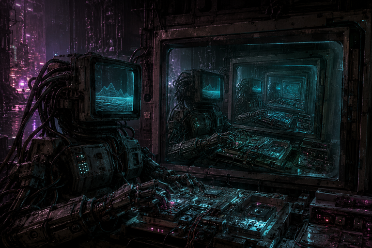

# CGVM

> Draws with great difficulty.

CGVM is an experimental fantasy computer for rendering and small games. Its
default demo, Astra, is a guest-programmed flight game in a realistically scaled
Solar System. Planet positions are fixed demonstrations, not live ephemerides.



## Build and run

Requires a C23 compiler, Bash, pkg-config, SDL3, and libPNG. Run from the
repository root:

```sh
bash bismilla.sh
./cgvm.elf
```

Close the window to exit and save the final frame to `test.png`.

## Controls

| Key | Action |
| --- | --- |
| Arrow keys | Manual steering |
| Z / X | Accelerate / brake; X also cancels cruise |
| F | Cycle FLIGHT (0–9,000 km/s), SYSTEM (0–900,000 km/s), and LOCAL (0–10 m/s); reset throttle and cancel cruise |
| Tab | Cycle Sol, the planets including Pluto, 13 moons, Ceres, and Vesta |
| T | Cruise to the selected destination, or cancel |
| M | Show or hide the system map |

The game starts in FLIGHT mode. Cruise is fictional high-speed travel that stops
outside the destination and checks the route for collisions. The map compresses
orbital spacing; the flight view uses physical body scale. Procedural asteroids
are sparse and appear only at close range.

See the [Solar System flight reference](docs/solar-system.md) for travel rules,
rendering, source data, and limitations.

## Validation

Run the headless regression suite with a C23 compiler; SDL3 and libPNG are not
required:

```sh
sh tests/run.sh
```

The machine core is `src/vm/machine.c`; it can be linked without SDL or libPNG.
Machine instances are large and should be allocated statically or on the heap.

## Documentation

- [Documentation index](docs/README.md): all references and earlier demo documentation.
- [Instruction set reference](docs/isa.md): implemented CPU contract and opcode table.
- [Bus and graphics reference](docs/devices.md): address map, GPU registers, clock, and input.
- [Machine architecture draft](docs/machine.md): proposed architecture; distinguishes planned facilities from implemented behavior.
- [Implementation status and limitations](docs/roadmap.md): current capabilities and unimplemented facilities.
